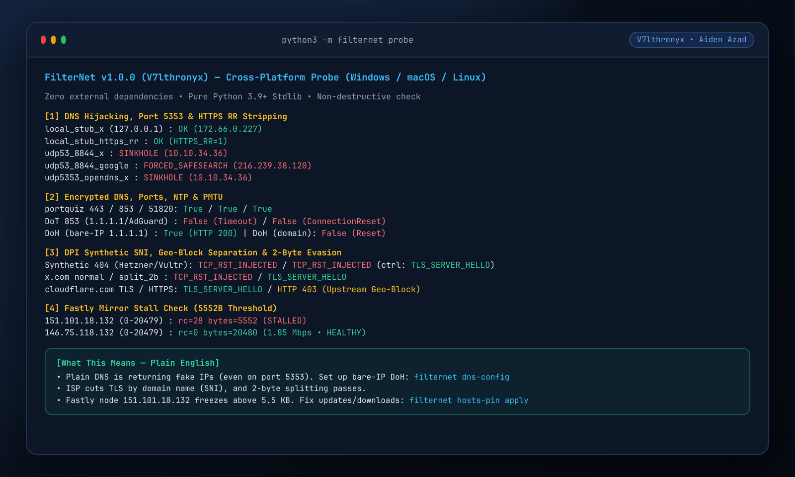
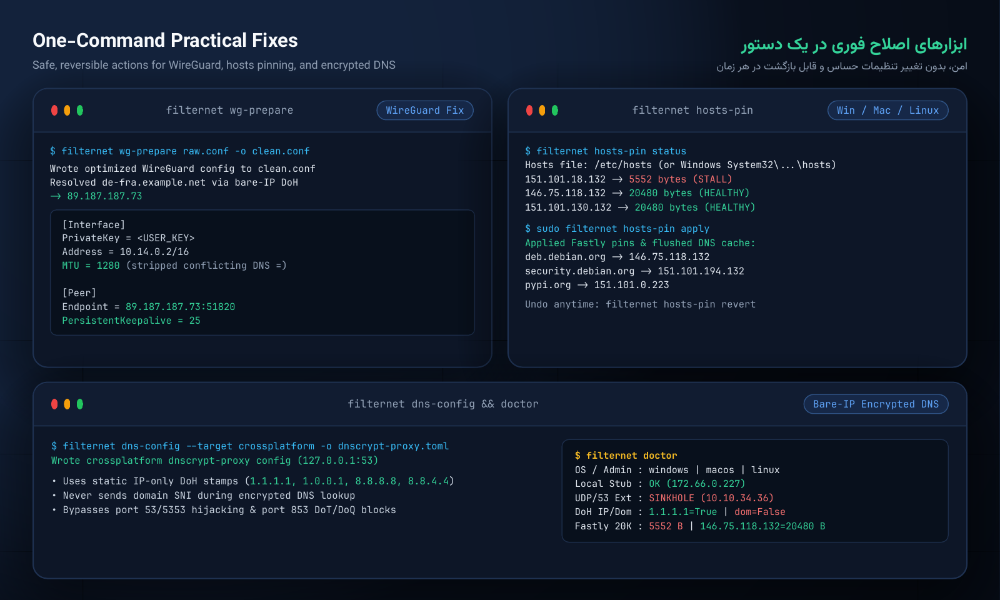
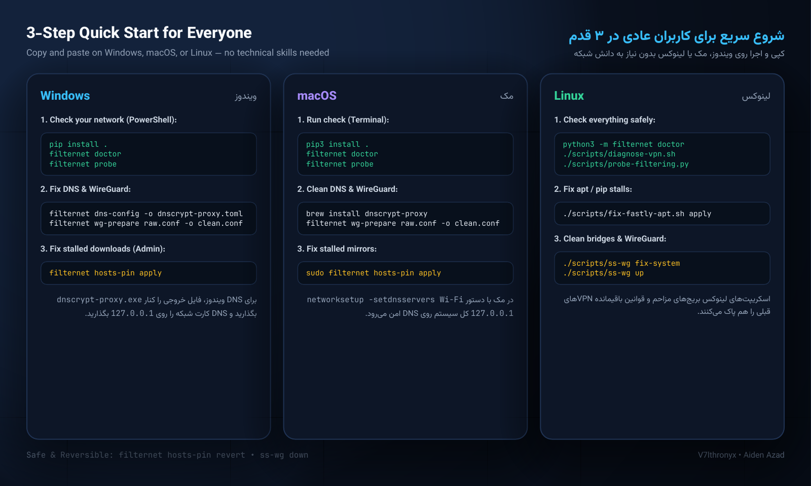

# FilterNet

**Fix broken DNS, stalled downloads, and failing VPNs on Windows, macOS, and Linux — in plain English.**

Built by **Aiden Azad** — **[V7lthronyx](https://github.com/v7lthronyx1)**

> **[راهنمای کامل فارسی (README_FA.md)](README_FA.md)** · **[Beginner Guide — No Tech Skills Needed (EN)](docs/BEGINNERS_GUIDE_EN.md)** · **[راهنمای ساده برای کاربران عادی (FA)](docs/BEGINNERS_GUIDE_FA.md)**

---

## What Is FilterNet? (Plain English)

Ever connected to Wi-Fi or mobile internet where Google opens fine, yet your VPN keeps spinning forever, Linux/Python updates freeze right after starting, or random sites fail for no clear reason?

Usually nothing is wrong with your laptop, phone, or cable. Your ISP is messing with traffic along the way — giving out fake DNS addresses, cutting connections mid-handshake when it sees a website name, or stalling specific servers after 5 kilobytes.

**FilterNet** checks what your connection is doing in ~10 seconds (using only built-in Python 3.9+, with nothing extra to install) and gives you simple, reversible fixes that work on **Windows**, **macOS**, and **Linux**.



---

## What Is Breaking Your Internet? (4 Things We Found)


| What You Notice | What Is Actually Happening | Exact Fix |
| :--- | :--- | :--- |
| Sites/VPNs hit dead pages or won't connect | Your ISP's DNS ("phonebook") hands out fake dead IPs like `10.10.34.36` — even on port `5353` and normal DoT/DoH domains. | `filternet dns-config` (Bare-IP encrypted DNS) |
| Downloads or `apt` / `pip` freeze at ~5 KB | Fastly server `151.101.18.132` stalls after `5,552 bytes`, while healthy neighbor Fastly servers work at full speed. | `sudo filternet hosts-pin apply` |
| WireGuard spins or connects with zero internet | Mobile networks drop oversized packets (`MTU`) and poison the server domain lookup. | `filternet wg-prepare raw.conf -o clean.conf` |
| Windscribe / Surfshark connects, pages time out | Hidden app tweaks (`Protocol Tweaks`, bad `Custom SNI`), leftover virtual bridges (`172.20.0.0/16`), or blackholed US/cloud routes. | Switch to EU (`Hetzner`/`Vultr`/DE/NL), run `filternet probe` |

---

## Visual Preview of the Fixes



---

## 3-Step Quick Start (Windows / macOS / Linux)



No `pip` dependencies required (`Python 3.9+` standard library only).

```bash
git clone https://github.com/v7lthronyx1/filternet.git
cd filternet
python3 -m filternet doctor
```

Or install the `filternet` command system-wide:

```bash
pip install .
```

### Everyday Commands

```bash
filternet doctor                                                # Safe read-only check with plain-English summary
filternet probe                                                 # Test DNS (53/5353), DPI (split_2b), Fastly stall & VPS routes
filternet hosts-pin status                                      # Check if Fastly 151.101.18.132 is stalling updates
sudo filternet hosts-pin apply                                  # Pin healthy download mirrors (Windows Admin / sudo)
sudo filternet hosts-pin revert                                 # Undo all hosts changes cleanly
filternet wg-prepare raw.conf -o clean.conf                     # Fix any WireGuard .conf (MTU 1280, Keepalive 25, DoH IP)
filternet dns-config --target crossplatform -o dnscrypt-proxy.toml  # Generate bare-IP DoH config for Windows/macOS/Linux
```

Not sure what Terminal or PowerShell commands to run? Follow the step-by-step **[Plain-Language Beginner Guide](docs/BEGINNERS_GUIDE_EN.md)** or **[Cross-Platform Setup Guide](docs/CROSS_PLATFORM_GUIDE.md)**.

---

## Extra Linux Scripts

For Linux users managing NetworkManager, `systemd-resolved`, and WireGuard endpoints:
- [`./scripts/diagnose-vpn.sh`](scripts/diagnose-vpn.sh) — Read-only system check (`ip rule`, orphan `172.20.0.0/16` bridges, Surfshark `cache.json`, DNS, Fastly, `PMTU`)
- [`./scripts/ss-wg`](scripts/ss-wg) — Clean conflicting VPN rules and rotate WireGuard endpoints (`fix-system`, `up`, `down`, `clean`, `status`)
- [`./scripts/fix-fastly-apt.sh`](scripts/fix-fastly-apt.sh) — Pin healthy Debian/PyPI mirrors and force IPv4 in APT (`status`, `apply`, `revert`)
- [`./scripts/probe-filtering.py`](scripts/probe-filtering.py) — Direct shortcut for `filternet probe`

---

## Deep Technical Docs & Companion Forensics

- [Plain-Language Guide (EN)](docs/BEGINNERS_GUIDE_EN.md) · [راهنمای ساده فارسی (FA)](docs/BEGINNERS_GUIDE_FA.md)
- [Cross-Platform Setup Guide](docs/CROSS_PLATFORM_GUIDE.md)
- [MCI (`AS197207`) 3-Session Forensic Findings](docs/MCI_FORENSIC_FINDINGS.md) — `134` forged `RST`s (`TTL=60`, `p=2.73e-34`), `12/20` dual-server synthetic SNI proof, `26/57` cloud disruption matrix, `5,552 B` Fastly threshold
- [Root Causes & Applied Fixes](docs/TIMELINE_AND_FIXES.md)
- [Manual Diagnostics Guide](docs/DIAGNOSTICS_GUIDE.md)
- Need full `dumpcap`/`tshark` PCAP captures and formal complaint PDFs (`195.cra.ir`)? Use **[shitnet](https://github.com/v7lthronyx1/shitnet)**.

---

## Security & License

No private keys, subscriber IPs, or raw packet captures live in this repo (see [SECURITY.md](SECURITY.md) and [CONTRIBUTING.md](CONTRIBUTING.md)).

MIT License — Copyright (c) 2026 **Aiden Azad (V7lthronyx)**
