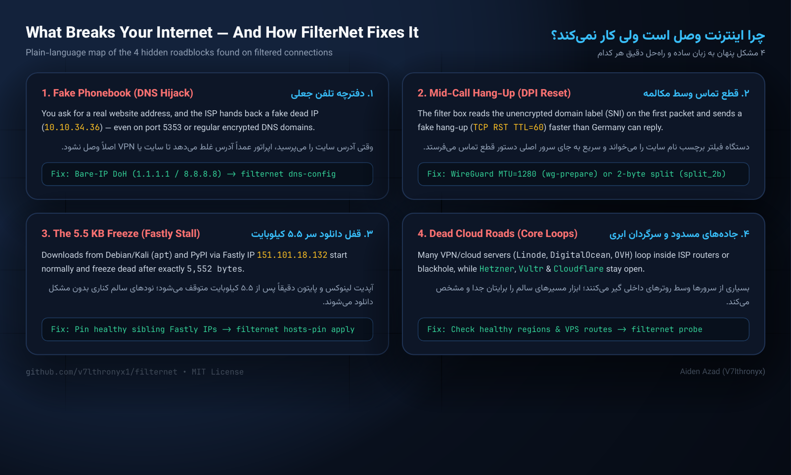

# FilterNet (فیلترنت)

**Fix broken DNS, stalled downloads, and failing VPNs on Windows, macOS, and Linux — in plain English and Persian.**

**رفع مشکل DNS، قفل شدن دانلودها و قطعی VPN روی ویندوز، مک و لینوکس — به زبان ساده برای همه**

Built by **Aiden Azad** — **[V7lthronyx](https://github.com/v7lthronyx1)**

> **[English Guide](#english)** · **[راهنمای کامل فارسی](#persian)** · **[Beginner Guide (EN)](docs/BEGINNERS_GUIDE_EN.md)** · **[راهنمای قدم‌به‌قدم فارسی (FA)](docs/BEGINNERS_GUIDE_FA.md)** · **[Dedicated Persian Page (README_FA.md)](README_FA.md)**

---

<a id="english"></a>

## English Guide

### What Is FilterNet? (Plain English)

Ever connected to Wi-Fi or mobile internet where Google opens fine, yet your VPN keeps spinning forever, Linux/Python updates freeze right after starting, or random sites fail for no clear reason?

Usually nothing is wrong with your laptop, phone, or cable. Your ISP is messing with traffic along the way — giving out fake DNS addresses, cutting connections mid-handshake when it sees a website name, or stalling specific servers after 5 kilobytes.

**FilterNet** checks what your connection is doing in ~10 seconds (using only built-in Python 3.9+, with nothing extra to install) and gives you simple, reversible fixes that work on **Windows**, **macOS**, and **Linux**.


### What Is Breaking Your Internet? (4 Things We Found)



| What You Notice | What Is Actually Happening | Exact Fix |
| :--- | :--- | :--- |
| Sites/VPNs hit dead pages or won't connect | Your ISP's DNS ("phonebook") hands out fake dead IPs like `10.10.34.36` — even on port `5353` and normal DoT/DoH domains. | `filternet dns-config` (Bare-IP encrypted DNS) |
| Downloads or `apt` / `pip` freeze at ~5 KB | Fastly server `151.101.18.132` stalls after `5,552 bytes`, while healthy neighbor Fastly servers work at full speed. | `sudo filternet hosts-pin apply` |
| WireGuard spins or connects with zero internet | Mobile networks drop oversized packets (`MTU`) and poison the server domain lookup. | `filternet wg-prepare raw.conf -o clean.conf` |
| Windscribe / Surfshark connects, pages time out | Hidden app tweaks (`Protocol Tweaks`, bad `Custom SNI`), leftover virtual bridges (`172.20.0.0/16`), or blackholed US/cloud routes. | Switch to EU (`Hetzner`/`Vultr`/DE/NL), run `filternet probe` |


### 3-Step Quick Start (Windows / macOS / Linux)


No `pip` dependencies required (`Python 3.9+` standard library only).

```bash
git clone https://github.com/v7lthronyx1/filternet.git
cd filternet
python3 -m filternet doctor
```

Or install the `filternet` command cleanly (`pipx install .` on Debian/Ubuntu/Kali, or `pip install .` on Windows/macOS/venv):

```bash
pipx install .
```

```bash
filternet doctor                                                    # Safe read-only check with plain-English summary
filternet probe                                                     # Test DNS (53/5353), DPI (split_2b/rec_split_2), Fastly stall & VPS routes
filternet probe -i eth0 --quick                                     # Bind probes directly to an ISP interface behind an active VPN
filternet hosts-pin status                                          # Check if Fastly 151.101.18.132 is stalling updates
sudo filternet hosts-pin apply                                      # Pin healthy download mirrors (Windows Admin / sudo)
sudo filternet hosts-pin revert                                     # Undo all hosts changes cleanly
filternet wg-prepare raw.conf -o clean.conf                         # Fix any WireGuard .conf (MTU 1280, Keepalive 25, DoH IP)
filternet dns-config --target crossplatform -o dnscrypt-proxy.toml  # Generate bare-IP DoH config for Windows/macOS/Linux
```

Not sure where to start? Read the **[Plain-Language Beginner Guide (EN)](docs/BEGINNERS_GUIDE_EN.md)** or **[Cross-Platform Setup Guide](docs/CROSS_PLATFORM_GUIDE.md)**.

### Extra Linux Scripts

- [`./scripts/diagnose-vpn.sh`](scripts/diagnose-vpn.sh) — Read-only check (`ip rule`, orphan `172.20.0.0/16` bridges, Surfshark `cache.json`, DNS, Fastly, `PMTU`)
- [`./scripts/ss-wg`](scripts/ss-wg) — Clean conflicting VPN rules and rotate WireGuard endpoints (`fix-system`, `up`, `down`, `clean`, `status`)
- [`./scripts/fix-fastly-apt.sh`](scripts/fix-fastly-apt.sh) — Pin healthy Debian/PyPI mirrors and force IPv4 in APT (`status`, `apply`, `revert`)
- [`./scripts/probe-filtering.py`](scripts/probe-filtering.py) — Direct shortcut for `filternet probe`

---

<a id="persian"></a>

## راهنمای کامل فارسی

### فیلترنت دقیقاً چه‌کار می‌کند؟ (به زبان ساده)

خیلی وقت‌ها اینترنت موبایل یا وای‌فای به ظاهر وصل است و گوگل باز می‌شود، ولی VPN مدام می‌چرخد و وصل نمی‌شود، دانلودهای لینوکس و پایتون همان ثانیه اول قفل می‌کنند، یا کلی از سایت‌ها بی‌دلیل خطا می‌دهند.

در بیشتر این موارد کامپیوتر یا گوشی شما هیچ مشکلی ندارد؛ اپراتور وسط راه دفترچه آدرس (`DNS`) را دستکاری می‌کند، هنگام شنیدن اسم سایت ارتباط را قطع می‌کند، یا برخی سرورها را بعد از ۵ کیلوبایت قفل می‌کند.

**FilterNet** در حدود ۱۰ ثانیه (فقط با خود Python 3.9+ و بدون نیاز به نصب هیچ پکیج اضافه‌ای) مشکل خط شما را پیدا می‌کند و راه‌حل‌های امن و قابل برگشت را روی **Windows**، **macOS** و **Linux** در اختیارتان می‌گذارد.

### ۴ مشکل پنهانی که اینترنت را از کار می‌اندازند

| مشکل شما چیست؟ | پشت صحنه دقیقاً چه اتفاقی می‌افتد؟ | راه‌حل مستقیم |
| :--- | :--- | :--- |
| سایت‌ها یا VPN اصلاً سرور را پیدا نمی‌کنند | DNS اپراتور آدرس جعلی و بن‌بست (`10.10.34.36`) تحویل می‌دهد — حتی روی پورت `5353` و دامنه‌های `DoT`/`DoH`. | `filternet dns-config` (تنظیم DoH فقط با IP) |
| دانلود و آپدیت `apt` / `pip` سر ۵ کیلوبایت قفل می‌کند | سرور Fastly با آی‌پی `151.101.18.132` بعد از `5,552 بایت` متوقف می‌شود، ولی نودهای کناری سالم‌اند. | `sudo filternet hosts-pin apply` |
| WireGuard وصل نمی‌شود یا با اتصال اینترنت ندارد | سایز بسته روی موبایل بزرگ است (`MTU`) و آدرس سرور از DNS مسموم گرفته می‌شود. | `filternet wg-prepare raw.conf -o clean.conf` |
| Windscribe / Surfshark وصل است ولی صفحه باز نمی‌شود | تیک‌های اضافی داخل برنامه (`Protocol Tweaks` یا `Custom SNI` اشتباه)، بریج‌های قدیمی لینوکس یا مسدود بودن سرورهای آمریکا. | تست سرورهای اروپا (`Hetzner`/`Vultr`/آلمان/هلند) و اجرای `filternet probe` |

### شروع سریع در ۳ قدم (Windows / macOS / Linux)

بدون نیاز به نصب پکیج خارجی (فقط `Python 3.9+`):

```bash
git clone https://github.com/v7lthronyx1/filternet.git
cd filternet
python3 -m filternet doctor
```

یا نصب دستور سراسری `filternet` (در ویندوز/مک با `pip install .` و در دبیان/اوبونتو/کالی با `pipx install .` یا داخل venv):

```bash
pipx install .
```

### دستورات کاربردی روزمره

```bash
filternet doctor                                                # بررسی سریع و امن همراه با توضیح ساده مشکل
filternet probe                                                 # تست DNS (53/5353)، بایپس split_2b/rec_split_2، قفل Fastly و وضعیت کلودها
filternet probe -i eth0 --quick                                 # اجرای مستقیم تست روی کارت شبکه اپراتور از پشت VPN فعال
filternet hosts-pin status                                      # بررسی قفل بودن نود 151.101.18.132 برای دانلودها
sudo filternet hosts-pin apply                                  # پین کردن نود سالم Fastly (در ویندوز با Admin / مک و لینوکس با sudo)
sudo filternet hosts-pin revert                                 # بازگرداندن فایل hosts به حالت اول
filternet wg-prepare raw.conf -o clean.conf                     # بهینه‌سازی هر فایل WireGuard (تنظیم MTU 1280 و Keepalive 25)
filternet dns-config --target crossplatform -o dnscrypt-proxy.toml  # ساخت کانفیگ آماده dnscrypt-proxy با DoH مبتنی بر IP
```

### نحوه استفاده خیلی ساده روی هر سیستم‌عامل
- **روی ویندوز (Windows):** `PowerShell` را با **Run as Administrator** باز کنید، `pip install .` و بعد `filternet doctor` بزنید. اگر دانلودها قفل بود `filternet hosts-pin apply` بزنید. برای DNS، فایل خروجی `filternet dns-config -o dnscrypt-proxy.toml` را کنار `dnscrypt-proxy.exe` بگذارید، سرویسش را اجرا کنید و DNS کارت شبکه را روی `127.0.0.1` بگذارید.
- **روی مک (macOS):** در `Terminal` دستورهای `pip3 install .` و `filternet doctor` و `sudo filternet hosts-pin apply` را بزنید. برای DNS از `brew install dnscrypt-proxy` و دستور `networksetup -setdnsservers Wi-Fi 127.0.0.1` استفاده کنید.
- **روی لینوکس (Linux):** علاوه بر دستورهای بالا، اسکریپت‌های [`./scripts/diagnose-vpn.sh`](scripts/diagnose-vpn.sh)، [`./scripts/fix-fastly-apt.sh`](scripts/fix-fastly-apt.sh) و [`./scripts/ss-wg`](scripts/ss-wg) تداخل‌های `NetworkManager`، بریج‌های `172.20.0.0/16`، قفل `apt` و چرخش سرورهای WireGuard را هم خودکار انجام می‌دهند.

اگر با ترمینال یا اصطلاحات شبکه آشنا نیستید، حتماً **[راهنمای قدم‌به‌قدم برای کاربران عادی (فارسی)](docs/BEGINNERS_GUIDE_FA.md)** را بخوانید.

---

## Docs, Forensics & Repository Map

- [Beginner Guide — No Tech Skills Needed (EN)](docs/BEGINNERS_GUIDE_EN.md) · [راهنمای ساده فارسی (FA)](docs/BEGINNERS_GUIDE_FA.md)
- [Cross-Platform Setup Guide](docs/CROSS_PLATFORM_GUIDE.md)
- [MCI (`AS197207`) 4-Session Forensic Findings](docs/MCI_FORENSIC_FINDINGS.md)
- [Root Causes & Applied Fixes](docs/TIMELINE_AND_FIXES.md)
- [Manual Diagnostics Guide](docs/DIAGNOSTICS_GUIDE.md)
- Full `dumpcap`/`tshark` PCAP captures & legal complaint PDFs (`195.cra.ir`): **[shitnet](https://github.com/v7lthronyx1/shitnet)**

No private keys, subscriber IPs, or raw packet captures live in this repo ([SECURITY.md](SECURITY.md) · [CONTRIBUTING.md](CONTRIBUTING.md)).

MIT License — Copyright (c) 2026 **Aiden Azad (V7lthronyx)**
