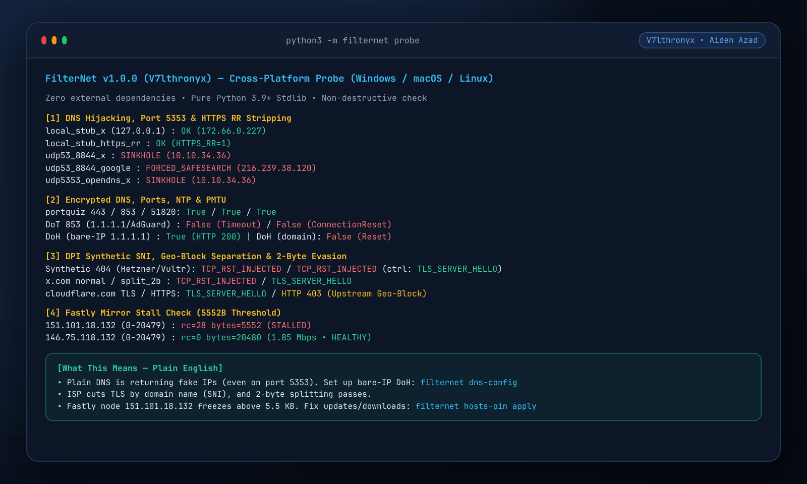
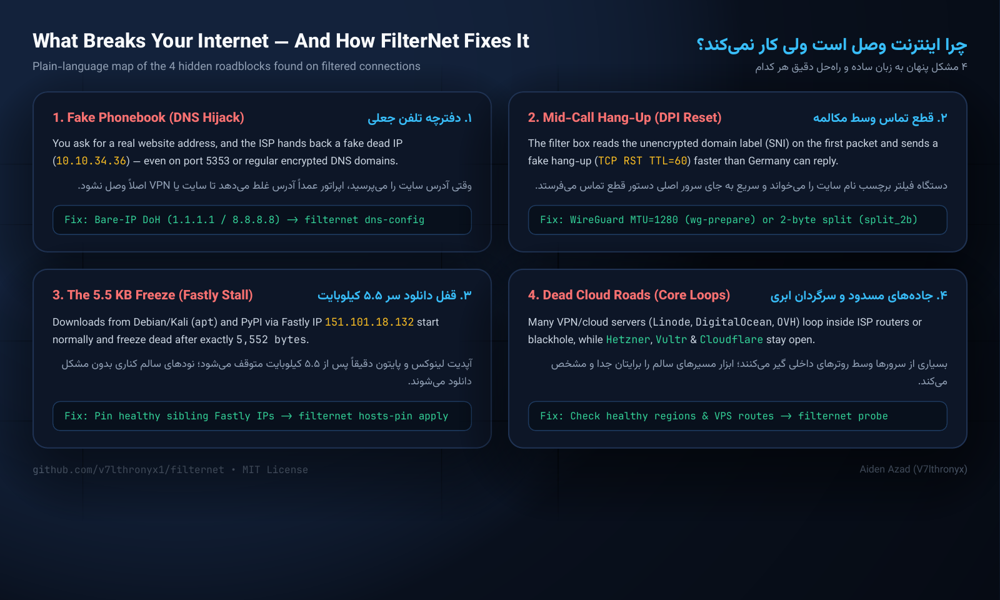
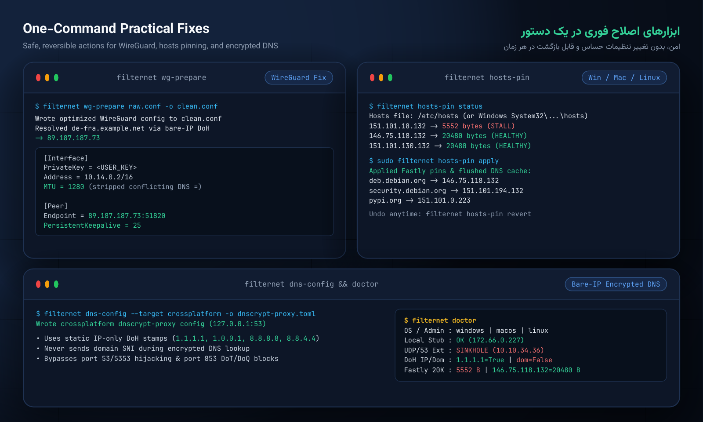
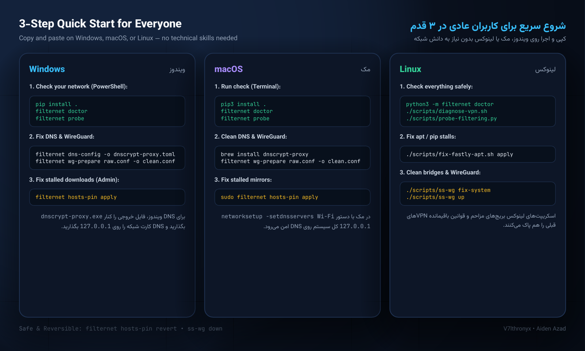

# FilterNet (فیلترنت)

**رفع مشکل DNS، قفل شدن دانلودها و قطعی VPN روی ویندوز، مک و لینوکس — بدون نیاز به دانش فنی**

ساخته‌شده توسط **Aiden Azad** — **[V7lthronyx](https://github.com/v7lthronyx1)**

> **[English README (README.md)](README.md)** · **[راهنمای ساده برای کاربران عادی (فارسی)](docs/BEGINNERS_GUIDE_FA.md)** · **[Plain-Language Guide (English)](docs/BEGINNERS_GUIDE_EN.md)**

---

## فیلترنت دقیقاً چه‌کار می‌کند؟ (به زبان ساده)

خیلی وقت‌ها اینترنت موبایل یا وای‌فای به ظاهر وصل است و گوگل باز می‌شود، ولی VPN مدام می‌چرخد و وصل نمی‌شود، دانلودهای لینوکس و پایتون همان ثانیه اول قفل می‌کنند، یا کلی از سایت‌ها بی‌دلیل خطا می‌دهند.

در بیشتر این موارد کامپیوتر یا گوشی شما هیچ مشکلی ندارد؛ اپراتور وسط راه دفترچه آدرس (`DNS`) را دستکاری می‌کند، هنگام شنیدن اسم سایت ارتباط را قطع می‌کند، یا برخی سرورها را بعد از ۵ کیلوبایت قفل می‌کند.

**FilterNet** در حدود ۱۰ ثانیه (فقط با خود Python 3.9+ و بدون نیاز به نصب هیچ پکیج اضافه‌ای) مشکل خط شما را پیدا می‌کند و راه‌حل‌های امن و قابل برگشت را روی **Windows**، **macOS** و **Linux** در اختیارتان می‌گذارد.



---

## ۴ مشکل پنهانی که اینترنت را از کار می‌اندازند



| مشکل شما چیست؟ | پشت صحنه دقیقاً چه اتفاقی می‌افتد؟ | راه‌حل مستقیم |
| :--- | :--- | :--- |
| سایت‌ها یا VPN اصلاً سرور را پیدا نمی‌کنند | DNS اپراتور آدرس جعلی و بن‌بست (`10.10.34.36`) تحویل می‌دهد — حتی روی پورت `5353` و دامنه‌های `DoT`/`DoH`. | `filternet dns-config` (تنظیم DoH فقط با IP) |
| دانلود و آپدیت `apt` / `pip` سر ۵ کیلوبایت قفل می‌کند | سرور Fastly با آی‌پی `151.101.18.132` بعد از `5,552 بایت` متوقف می‌شود، ولی نودهای کناری سالم‌اند. | `sudo filternet hosts-pin apply` |
| WireGuard وصل نمی‌شود یا با اتصال اینترنت ندارد | سایز بسته روی موبایل بزرگ است (`MTU`) و آدرس سرور از DNS مسموم گرفته می‌شود. | `filternet wg-prepare raw.conf -o clean.conf` |
| Windscribe / Surfshark وصل است ولی صفحه باز نمی‌شود | تیک‌های اضافی داخل برنامه (`Protocol Tweaks` یا `Custom SNI` اشتباه)، بریج‌های قدیمی لینوکس یا مسدود بودن سرورهای آمریکا. | تست سرورهای اروپا (`Hetzner`/`Vultr`/آلمان/هلند) و اجرای `filternet probe` |

---

## پیش‌نمایش دستورات اصلاح فوری



---

## شروع سریع در ۳ قدم (Windows / macOS / Linux)



بدون نیاز به نصب پکیج خارجی (فقط `Python 3.9+`):

```bash
git clone https://github.com/v7lthronyx1/filternet.git
cd filternet
python3 -m filternet doctor
```

یا نصب به‌عنوان دستور سراسری `filternet`:

```bash
pip install .
```

### دستورات کاربردی روزمره

```bash
filternet doctor                                                # بررسی سریع و امن همراه با توضیح ساده مشکل
filternet probe                                                 # تست DNS (53/5353)، بایپس split_2b، قفل Fastly و وضعیت کلودها
filternet hosts-pin status                                      # بررسی قفل بودن نود 151.101.18.132 برای دانلودها
sudo filternet hosts-pin apply                                  # پین کردن نود سالم Fastly (در ویندوز با Admin / مک و لینوکس با sudo)
sudo filternet hosts-pin revert                                 # بازگرداندن فایل hosts به حالت اول
filternet wg-prepare raw.conf -o clean.conf                     # بهینه‌سازی هر فایل WireGuard (تنظیم MTU 1280 و Keepalive 25)
filternet dns-config --target crossplatform -o dnscrypt-proxy.toml  # ساخت کانفیگ آماده dnscrypt-proxy با DoH مبتنی بر IP
```

اگر با ترمینال یا مفاهیم شبکه آشنا نیستید، **[راهنمای ساده قدم‌به‌قدم فارسی](docs/BEGINNERS_GUIDE_FA.md)** یا **[راهنمای نصب روی ویندوز، مک و لینوکس](docs/CROSS_PLATFORM_GUIDE.md)** را بخوانید.

---

## اسکریپت‌های ویژه لینوکس

برای مدیریت کامل `NetworkManager`، `systemd-resolved` و پروفیل‌های وایرگارد روی لینوکس:
- [`./scripts/diagnose-vpn.sh`](scripts/diagnose-vpn.sh) — بررسی کامل و فقط‌خواندنی شبکه، بریج‌های `172.20.0.0/16`، قوانین `ip rule`/`nft`، کش Surfshark، DNS و `PMTU`
- [`./scripts/ss-wg`](scripts/ss-wg) — پاک‌سازی تداخل‌های سیستمی و چرخش خودکار سرورهای WireGuard (`fix-system`، `up`، `down`، `clean`، `status`)
- [`./scripts/fix-fastly-apt.sh`](scripts/fix-fastly-apt.sh) — پین کردن نودهای سالم Debian/PyPI در `/etc/hosts` و فعال‌سازی IPv4 در APT (`status`، `apply`، `revert`)
- [`./scripts/probe-filtering.py`](scripts/probe-filtering.py) — اجرای مستقیم `filternet probe`

---

## مستندات فنی و ابزار جرم‌شناسی مکمل

- [راهنمای ساده برای کاربران عادی (فارسی)](docs/BEGINNERS_GUIDE_FA.md) · [Plain-Language Guide (EN)](docs/BEGINNERS_GUIDE_EN.md)
- [راهنمای نصب روی ویندوز، مک و لینوکس](docs/CROSS_PLATFORM_GUIDE.md)
- [یافته‌های جرم‌شناسی سه‌مرحله‌ای همراه اول (`AS197207`)](docs/MCI_FORENSIC_FINDINGS.md) — ثبت `134` بسته جعلی `RST` با `TTL=60` و `p=2.73e-34`، آزمون دو-سروری `probe-test-404.*` (`12/20`)، اختلال `45.6%` سرویس‌های ابری (`26/57`) و قفل بایت `5552` روی Fastly
- [شرح کامل خطاها و راه‌حل‌های سیستم](docs/TIMELINE_AND_FIXES.md)
- [راهنمای دستورات تشخیصی دستی](docs/DIAGNOSTICS_GUIDE.md)
- اگر قصد ثبت شکایت رسمی در سامانه **۱۹۵** یا گرفتن کپچر `PCAPNG` و PDF شکایت دارید، از پروژه مکمل **[shitnet](https://github.com/v7lthronyx1/shitnet)** استفاده کنید.

---

## امنیت و لایسنس

هیچ کلید خصوصی، IP مشترک یا فایل کپچر خام در این مخزن ذخیره نمی‌شود (مطالعه [SECURITY.md](SECURITY.md) و [CONTRIBUTING.md](CONTRIBUTING.md)).

منتشرشده تحت لایسنس **MIT** — **Aiden Azad (V7lthronyx)**
