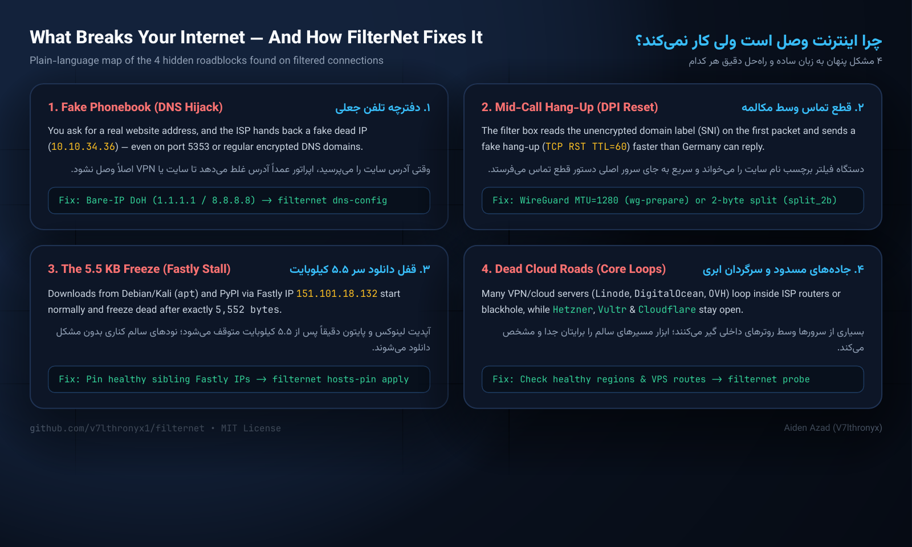
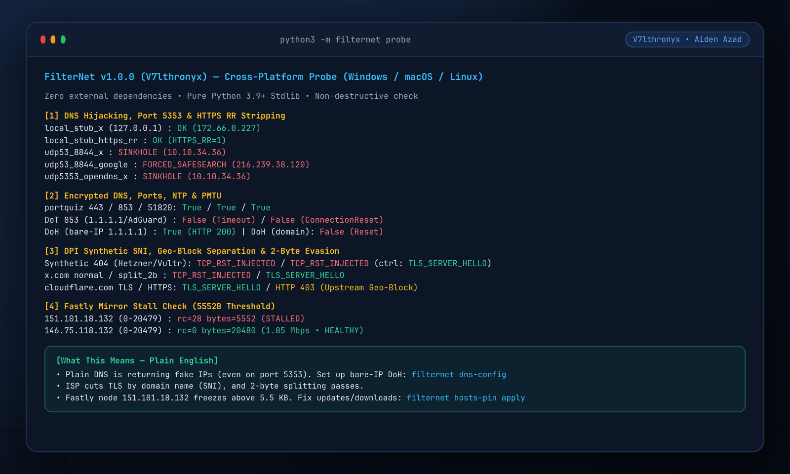
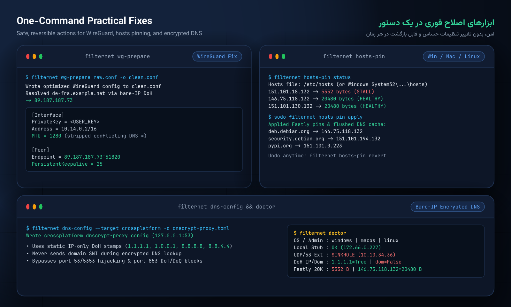

# Plain-Language Guide (No Tech Background Needed)

> نسخه فارسی این راهنما: [راهنمای ساده و کامل فارسی](BEGINNERS_GUIDE_FA.md)

If you have ever stared at your screen wondering why Google loads fine while your VPN spins forever, downloads stop right at the beginning, or certain apps say "no internet" even though Wi-Fi is full — this guide is for you.

You do **not** need to understand networking to use **FilterNet**. Everything here is safe, touches zero personal files, and every single change can be undone with one command.

---

## First: What Is Actually Breaking Your Internet? (In Plain Words)

When internet looks "connected" on paper yet fails in practice, it usually boils down to four tricks happening between your device and the outside world:



1. **The Fake Phonebook (DNS Hijacking):**
   Think of DNS like a contacts list that turns a name like `youtube.com` into a server address. On filtered lines, your internet provider swaps in a dead dummy address (`10.10.34.36`), so your browser or VPN knocks on an empty door.
2. **Someone Listening & Hanging Up Mid-Call (DPI):**
   Even when you have the real address, a box in the middle peeks at the website name in your first packet and sends a fake "hang up" signal before the real server can even answer.
3. **The 5.5 KB Freeze (Fastly Download Stall):**
   Software updates on Linux (`apt`), Python packages (`pip`), and several developer mirrors download the first 5 kilobytes normally and then freeze dead forever. Switching to a healthy mirror server next door fixes it immediately.
4. **Dead Roads to Specific Hosting Companies:**
   Some major cloud companies (like Linode, DigitalOcean, and OVH) get stuck in router loops or silent blackholes on Iranian mobile lines, while others (like Hetzner, Vultr, and Cloudflare) connect fine.

---

## Step 1: Make Sure You Have Python Installed

FilterNet runs using **Python** (version 3.9 or newer). You do not need to install any extra Python libraries.

- **Windows:** Open PowerShell (press the Windows key, type `powershell`, press Enter) and type:
  ```powershell
  python --version
  ```
  If Windows opens the Microsoft Store or says it is missing, install Python from [python.org/downloads](https://www.python.org/downloads/) and **make sure to check "Add Python to PATH"** on the first screen.
- **macOS:** Open Terminal (`Cmd + Space`, type `Terminal`, press Enter) and type:
  ```bash
  python3 --version
  ```
- **Linux:** Almost every Linux distro already includes Python 3 (`python3 --version`).

Download or clone FilterNet, then move into the folder:
```bash
git clone https://github.com/v7lthronyx1/filternet.git
cd filternet
```
*(No `git`? On GitHub click the green **Code** button -> **Download ZIP**, extract it, and open Terminal/PowerShell inside that folder.)*

Optional install so you can type `filternet` from any folder:
```bash
pip install .
```
*(Or skip installing and just put `python -m ` or `python3 -m ` in front of every `filternet` command below.)*

---

## Step 2: Check What Is Happening (`doctor` & `probe`)

Run this first. It only reads and tests — it changes **nothing** on your computer:

```bash
python3 -m filternet doctor
```

Want the deeper check (takes ~15 seconds and tests DNS tricks, website cutoffs, download freezes, and cloud servers)? Run:

```bash
python3 -m filternet probe
```

At the bottom of both commands, look at the **`[What This Means]`** section. It tells you in plain English what passed, what got blocked, and which exact command fixes it.



---

## Step 3: Pick the Fix You Need



### Fix A — Your Downloads or Updates Freeze Right After Starting (`apt` / `pip`)
If `apt update` or `pip install` hangs forever at 0% or after a few kilobytes:

1. Check if the broken mirror (`151.101.18.132`) is stalling on your line:
   ```bash
   python3 -m filternet hosts-pin status
   ```
2. Apply the fix (run PowerShell **as Administrator** on Windows, or use `sudo` on macOS/Linux):
   ```bash
   sudo python3 -m filternet hosts-pin apply
   ```
   This tests healthy backup mirror servers first and points your computer's `hosts` file to the working ones (and saves a backup automatically).
3. Want to undo it later? One command puts everything back:
   ```bash
   sudo python3 -m filternet hosts-pin revert
   ```

---

### Fix B — Your WireGuard VPN Won't Connect or Has "No Internet" After Connecting
Mobile hotspots and USB tethering often break standard VPN configs because packet sizes are slightly too big and the server domain gets poisoned by DNS.

1. Download your WireGuard `.conf` file from your VPN provider (Surfshark, Proton, Mullvad, or your own server).
2. Clean it up with FilterNet:
   ```bash
   python3 -m filternet wg-prepare my-vpn.conf -o fixed-vpn.conf
   ```
   This automatically sets the right packet size (`MTU = 1280`), keeps the tunnel awake (`PersistentKeepalive = 25`), removes conflicting DNS lines, and resolves the real server IP safely.
3. Import `fixed-vpn.conf` into the official WireGuard app on Windows/macOS — or on Linux run:
   ```bash
   ./scripts/ss-wg fix-system
   ./scripts/ss-wg up fixed-vpn.conf
   ```

---

### Fix C — Stop Fake DNS Responses Everywhere (`dnscrypt-proxy`)
Normal encrypted DNS settings in Windows/browsers often fail because the filter blocks port `853` and cuts connections to domains like `cloudflare-dns.com` or `dns.google`.

The trick that still works is **talking directly to Cloudflare/Google IPs over HTTPS (`1.1.1.1` / `8.8.8.8`) without saying a domain name**.

1. Generate the config file:
   - **Windows / macOS:**
     ```bash
     python3 -m filternet dns-config --target crossplatform -o dnscrypt-proxy.toml
     ```
   - **Linux (`systemd`):**
     ```bash
     python3 -m filternet dns-config --target systemd -o dnscrypt-proxy.toml
     ```
2. Put that file into your `dnscrypt-proxy` folder (or `/etc/dnscrypt-proxy/dnscrypt-proxy.toml` on Linux), start `dnscrypt-proxy`, and set your computer's DNS to `127.0.0.1` (`127.0.2.1` on systemd Linux).
3. For exact Windows/macOS click-by-click steps, see [CROSS_PLATFORM_GUIDE.md](CROSS_PLATFORM_GUIDE.md).

---

### Fix D — Using Windscribe or Surfshark Desktop Apps on Mobile Internet
A few hidden settings inside the VPN apps themselves frequently cause connection loops on Iranian mobile carriers:

- **Never run two VPNs at once** (nor old leftover VPN services on Linux — `./scripts/ss-wg fix-system` cleans them).
- **In Windscribe:**
  - Leave **Custom SNI** blank, or type just `github.com` (never `https://github.com/`).
  - Turn **OFF** `Protocol Tweaks` (it can truncate packets on `WStunnel`/`Stealth`).
  - Turn **OFF** `MAC Spoofing (Auto-rotate)` if switching Wi-Fi/USB freezes for 30+ seconds.
  - If US locations connect with zero internet, switch to **Germany (Frankfurt)** or **Netherlands (Amsterdam)**.
- **In Surfshark (Linux):**
  - Do not mix Snap/Flatpak versions with the official `.deb` package.
  - If OpenVPN shows connected yet nothing loads, run `./scripts/diagnose-vpn.sh` to check for leftover `172.20.0.0/16` Docker bridges blocking Surfshark's internal route.

---

## Quick Dictionary (Jargon -> Normal Human Words)

| Word you might see | What it really means |
| :--- | :--- |
| **DNS** | The internet's phonebook (turns `google.com` into a number like `142.250.x.x`). |
| **Sinkhole (`10.10.34.36`)** | A fake dead address your ISP returns instead of the real website. |
| **DoH / Bare-IP DoH** | Asking the phonebook privately over HTTPS. Bare-IP means calling `1.1.1.1` directly without saying a domain name so the filter cannot sniff it. |
| **DPI / SNI Reset** | Middlebox hardware peeking at the website name in your first packet and hanging up on both sides (`TCP RST`). |
| **`split_2b`** | Splitting that first packet into tiny 2-byte pieces so the shallow filter box misses the website name. |
| **MTU (`1280`)** | Maximum packet box size. Lowering it prevents encrypted VPN packets from getting dropped on mobile networks. |
| **Fastly (`151.101.18.132`)** | A shared server used by Debian, Kali, and Python (`pypi.org`). That specific IP stalls after `5,552 bytes`, so pinning to sibling IPs fixes downloads. |

---

## Common Questions

- **Is running `hosts-pin apply` or `doctor` safe?**
  Yes. `doctor` and `probe` only read and test. `hosts-pin apply` backs up your `hosts` file first (`hosts.filternet.bak`) and `hosts-pin revert` removes every line FilterNet added.
- **Why does `hosts-pin apply` ask for Administrator / `sudo`?**
  Windows, macOS, and Linux protect the system `hosts` file so random websites/apps cannot edit it without your permission.
- **What if I want to share my test results without leaking my IP?**
  Run `filternet probe --json`, and make sure you do not paste your personal home/SIM public IP or WireGuard private keys when posting online.
