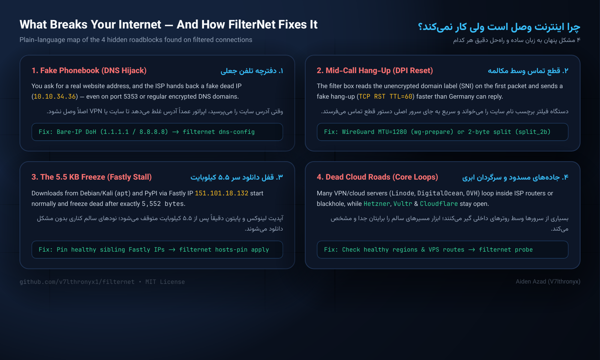
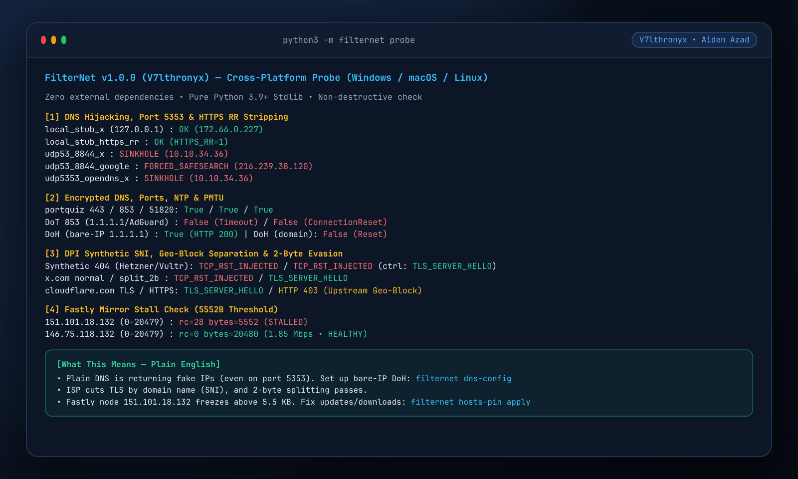
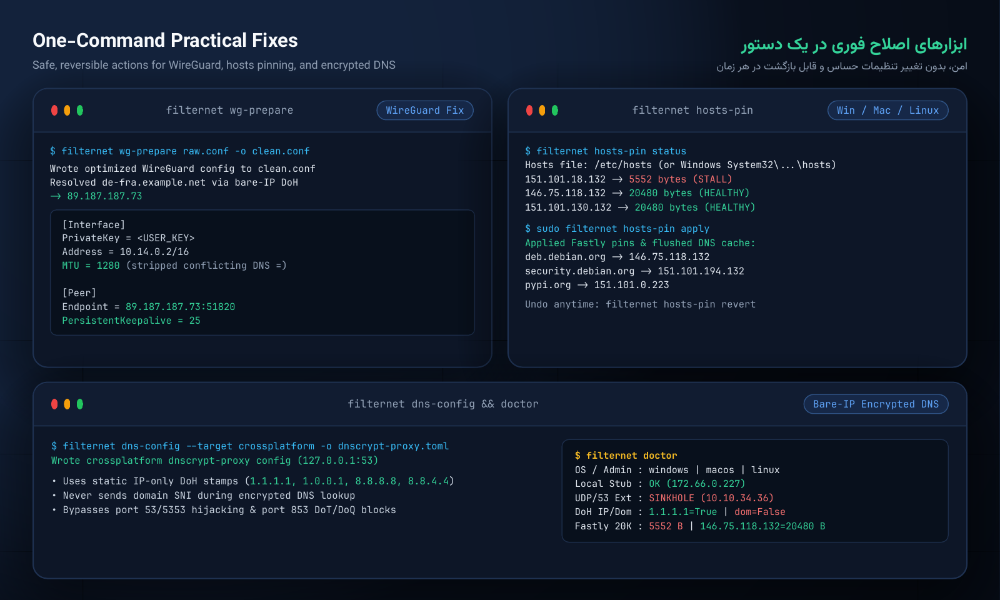

# راهنمای ساده و کامل (بدون نیاز به دانش فنی)

> English version of this guide: [Plain-Language Guide (English)](BEGINNERS_GUIDE_EN.md)

اگر تا به حال برایتان پیش آمده که گوشی یا کامپیوترتان به اینترنت وصل باشد، گوگل راحت باز شود، اما VPN مدام بچرخد و وصل نشود، دانلودهایتان همان اول قفل کنند یا کلی از سایت‌ها و ابزارهای برنامه‌نویسی باز نشوند — این راهنما دقیقاً برای شما نوشته شده است.

برای استفاده از **FilterNet** نیازی به هیچ دانش شبکه یا تخصص لینوکس ندارید. تمام تست‌ها امن هستند، به فایل‌های شخصی شما کاری ندارند و هر تغییری که بدهید با یک دستور به حالت اول برمی‌گردد.

---

## اول به زبان ساده: دقیقاً چه چیزی اینترنت را خراب می‌کند؟

وقتی اینترنت روی کاغذ وصل است اما در عمل کار نمی‌کند، معمولاً یکی از این ۴ اتفاق پشت صحنه در حال رخ دادن است:



۱. **دفترچه تلفن جعلی (مسمومیت DNS):**
   هر سایتی قبل از باز شدن باید از یک «دفترچه تلفن» آدرس عددی‌اش پیدا شود. روی اینترنت فیلترشده، اپراتور عمداً یک آدرس جعلی و مرده (`10.10.34.36`) تحویل می‌دهد تا مرورگر یا VPN اصلاً به سرور اصلی نرسد.
۲. **شنود و قطع کردن تماس وسط راه (DPI):**
   حتی وقتی آدرس واقعی سرور را دارید، دستگاهی سر راه اسم سایت را از بسته اول می‌خواند و سریع یک دستور قطع تماس جعلی می‌فرستد تا ارتباط بسته شود.
۳. **قفل شدن دانلود دقیقاً سر ۵.۵ کیلوبایت (مشکل Fastly):**
   خیلی از دانلودهای لینوکس (`apt`) و پایتون (`pip`) از آدرس `151.101.18.132` چند کیلوبایت اول را می‌گیرند و بعد برای همیشه قفل می‌شوند. کافی است مسیر دانلود را روی آی‌پی سالم کناری بگذاریم تا مشکل کامل حل شود.
۴. **جاده‌های مسدود به برخی دیتاسنترها:**
   سرورهای بعضی شرکت‌های معروف (مثل `Linode`، `DigitalOcean` و `OVH`) در روترهای داخلی اپراتور گیر می‌کنند یا بسته می‌شوند، در حالی که شرکت‌هایی مثل `Hetzner`، `Vultr` و `Cloudflare` باز و پرسرعت‌اند.

---

## قدم اول: مطمئن شوید Python نصب است

ابزار **FilterNet** فقط با خود **Python** (نسخه ۳.۹ به بالا) کار می‌کند و نیاز به نصب هیچ پکیج سنگینی ندارد.

- **روی ویندوز (Windows):** کلید ویندوز را بزنید، عبارت `powershell` را بنویسید و Enter بزنید. بعد این دستور را وارد کنید:
  ```powershell
  python --version
  ```
  اگر ویندوز صفحه نصب Microsoft Store را باز کرد یا خطا داد، پایتون را از [python.org/downloads](https://www.python.org/downloads/) دانلود کنید و در صفحه اول نصب حتماً تیک **Add Python to PATH** را بزنید.
- **روی مک (macOS):** با `Cmd + Space` برنامه `Terminal` را باز کنید و بزنید:
  ```bash
  python3 --version
  ```
- **روی لینوکس (Linux):** تقریباً تمام توزیع‌ها به‌طور پیش‌فرض پایتون ۳ را دارند.

حالا پروژه را دانلود کنید و وارد پوشه‌اش شوید:
```bash
git clone https://github.com/v7lthronyx1/filternet.git
cd filternet
```
*(اگر `git` ندارید، در صفحه گیت‌هاب روی دکمه سبز **Code** و سپس **Download ZIP** بزنید، فایل را اکسترکت کنید و ترمینال/PowerShell را داخل همان پوشه باز کنید.)*

نصب اختیاری تا دستور `filternet` همه‌جا در دسترس باشد (روی ویندوز/مک `pip install .` و روی دبیان/اوبونتو/کالی از `pipx install .` استفاده کنید):
```bash
pipx install .
```
*(اگر نخواستید نصب کنید، فقط کافی است قبل از دستورات پایین `python -m ` یا `python3 -m ` اضافه کنید.)*

---

## قدم دوم: وضعیت اینترنت خودتان را ببینید (`doctor` و `probe`)

این دو دستور فقط وضعیت را بررسی می‌کنند و **هیچ تغییری** روی سیستم نمی‌دهند:

```bash
python3 -m filternet doctor
```

برای تست کامل‌تر (حدود ۱۵ ثانیه زمان می‌برد و DNS، قطع کردن سایت‌ها، قفل دانلود و سرورهای ابری را چک می‌کند):

```bash
python3 -m filternet probe
```

در انتهای خروجی هر دو دستور، بخش **`[What This Means]`** دقیق و ساده به شما می‌گوید چه چیزی خراب است و دقیقاً چه دستوری مشکلش را حل می‌کند.



---

## قدم سوم: انتخاب راه‌حل متناسب با مشکل شما



### راه‌حل ۱ — وقتی دانلودها یا آپدیت `apt` / `pip` همان اول قفل می‌شوند
اگر `apt update` یا نصب پکیج‌های پایتون سر صفر درصد یا ۵ کیلوبایت گیر می‌کند:

۱. اول وضعیت نود خراب (`151.101.18.132`) را چک کنید:
   ```bash
   python3 -m filternet hosts-pin status
   ```
۲. اصلاح را اجرا کنید (در ویندوز PowerShell را با **Run as Administrator** باز کنید و در مک/لینوکس از `sudo` استفاده کنید):
   ```bash
   sudo python3 -m filternet hosts-pin apply
   ```
   ابزار اول مطمئن می‌شود آی‌پی‌های جایگزین سالم‌اند، بعد از فایل `hosts` سیستم بکاپ می‌گیرد و آی‌پی سالم را ثبت می‌کند.
۳. هر زمان خواستید همه‌چیز را به حالت اول برگردانید:
   ```bash
   sudo python3 -m filternet hosts-pin revert
   ```

---

### راه‌حل ۲ — وقتی WireGuard وصل نمی‌شود یا بعد از اتصال اینترنت ندارد
روی اینترنت سیم‌کارت و هات‌اسپات موبایل، اندازه بسته‌های استاندارد برای وایرگارد کمی بزرگ است و آدرس سرور هم با DNS جعلی اشتباه باز می‌شود.

۱. فایل `.conf` وایرگارد را از سرویس VPN خودتان بگیرید.
۲. آن را با FilterNet استانداردسازی کنید:
   ```bash
   python3 -m filternet wg-prepare my-vpn.conf -o fixed-vpn.conf
   ```
   این دستور به‌صورت خودکار سایز بسته را (`MTU = 1280`) تنظیم می‌کند، تانل را بیدار نگه می‌دارد (`PersistentKeepalive = 25`)، خط DNS متداخل را پاک می‌کند و آی‌پی واقعی سرور را از طریق DoH امن پیدا می‌کند.
۳. فایل جدید `fixed-vpn.conf` را وارد برنامه رسمی WireGuard روی ویندوز یا مک کنید (یا روی لینوکس از `./scripts/ss-wg up fixed-vpn.conf` استفاده کنید).

---

### راه‌حل ۳ — خلاص شدن از دستکاری DNS در کل سیستم (`dnscrypt-proxy`)
در ایران حتی DNSهای رمزنگاری‌شده معمولی مثل پورت `853` یا دامنه‌های `cloudflare-dns.com` و `dns.google` هم مسدود می‌شوند.

تنها روشی که بدون VPN هم سالم می‌ماند، **پرس‌وجوی رمزنگاری‌شده مستقیم به آی‌پی `1.1.1.1` و `8.8.8.8` بدون فرستادن نام دامنه** است.

۱. فایل تنظیم آماده را بسازید:
   - **برای ویندوز و مک:**
     ```bash
     python3 -m filternet dns-config --target crossplatform -o dnscrypt-proxy.toml
     ```
   - **برای لینوکس (`systemd`):**
     ```bash
     python3 -m filternet dns-config --target systemd -o dnscrypt-proxy.toml
     ```
۲. فایل ساخته‌شده را در کنار برنامه `dnscrypt-proxy` (یا در لینوکس مسیر `/etc/dnscrypt-proxy/dnscrypt-proxy.toml`) قرار دهید، سرویس را روشن کنید و DNS سیستم را روی `127.0.0.1` (در لینوکس `127.0.2.1`) بگذارید.
۳. مراحل گام‌به‌گام برای ویندوز و مک در [CROSS_PLATFORM_GUIDE.md](CROSS_PLATFORM_GUIDE.md) نوشته شده است.

---

### راه‌حل ۴ — نکات مهم برنامه‌های Windscribe و Surfshark روی اینترنت موبایل
گاهی مشکل از خود اینترنت نیست و یک تیک اضافه داخل تنظیمات برنامه VPN اتصال را خراب می‌کند:

- **هرگز دو VPN را هم‌زمان روشن نکنید** (و در لینوکس با `./scripts/ss-wg fix-system` بقایای VPNهای قدیمی را پاک کنید).
- **در Windscribe:**
  - بخش `Custom SNI` را خالی بگذارید یا فقط `github.com` بنویسید (نه `https://github.com/`).
  - گزینه `Protocol Tweaks` را **خاموش** کنید (روی موبایل باعث خرابی بسته‌ها می‌شود).
  - گزینه `MAC Spoofing (Auto-rotate)` را **خاموش** کنید تا موقع جابه‌جایی وای‌فای و کابل USB سیستم ۳۰ ثانیه قفل نکند.
  - اگر سرورهای آمریکا وصل می‌شوند اما اینترنت ندارند، سرورهای **اروپا (آلمان / هلند)** را تست کنید.
- **در Surfshark (لینوکس):**
  - نسخه Snap و Flatpak را با نسخه رسمی `.deb` قاطی نکنید.
  - اگر OpenVPN وصل می‌شود اما صفحه‌ای باز نمی‌شود، `./scripts/diagnose-vpn.sh` را بزنید تا ببینید بریج‌های قدیمی Docker روی رنج `172.20.0.0/16` جلوی ترافیک را نگرفته باشند.

---

## فرهنگ لغت ساده (اصطلاحات فنی به زبان آدمیزاد)

| اصطلاح | معنی واقعی به زبان ساده |
| :--- | :--- |
| **DNS** | دفترچه تلفن اینترنت؛ اسم سایت را می‌گیرد و آدرس عددی سرور را برمی‌گرداند. |
| **Sinkhole (`10.10.34.36`)** | آدرس بن‌بست جعلی که مخابرات/اپراتور به جای آدرس واقعی سایت تحویل می‌دهد. |
| **DoH با IP خالص** | زنگ زدن رمزنگاری‌شده به `1.1.1.1` برای گرفتن آدرس سایت، بدون این‌که وسط راه کسی بفهمد چه اسمی را پرسیده‌اید. |
| **DPI / SNI Reset** | دستگاه شنود سر راه که اسم سایت را از اولین بسته می‌خواند و ارتباط را از وسط قطع می‌کند. |
| **`split_2b`** | خرد کردن بسته اول به تکه‌های کوچک ۲ بایتی تا دستگاه شنود نتواند اسم سایت را تشخیص دهد. |
| **MTU (`1280`)** | حداکثر اندازه جعبه بسته دیتا؛ کوچک کردن آن جلوی گم شدن بسته‌های VPN روی اینترنت موبایل را می‌گیرد. |
| **Fastly (`151.101.18.132`)** | یکی از سرورهای توزیع فایل دبیان و پایتون که روی همراه اول سر بایت ۵۵۵۲ قفل می‌کند و باید روی آی‌پی سالم کناری گذاشته شود. |

---

## سوالات رایج

- **آیا اجرای `hosts-pin apply` یا `doctor` خطرناک است؟**
  خیر. دستورهای `doctor` و `probe` فقط وضعیت را می‌خوانند. دستور `hosts-pin apply` قبل از تغییر فایل `hosts` یک بکاپ (`hosts.filternet.bak`) می‌گیرد و با `hosts-pin revert` همه‌چیز را پاک می‌کند.
- **چرا برای `hosts-pin apply` دسترسی Admin یا `sudo` می‌خواهد؟**
  چون فایل `hosts` جزو فایل‌های محافظت‌شده سیستم‌عامل است و هیچ برنامه‌ای بدون اجازه خود شما حق تغییر آن را ندارد.
- **اگر بخواهم خروجی تست را برای بقیه بفرستم امنیتم به خطر می‌افتد؟**
  مطمئن شوید قبل از انتشار عمومی، آی‌پی واقعی خانه/سیم‌کارت یا کلید خصوصی WireGuard داخل متنی که می‌فرستید نباشد.
